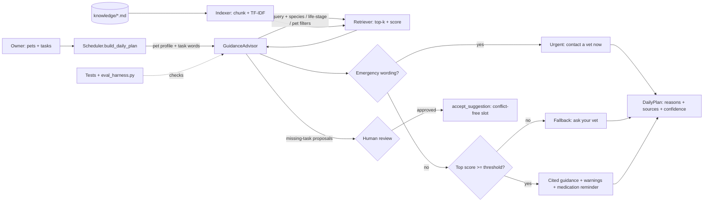

# PawPal+ with Grounded Care Guidance (RAG)

**Base project:** this extends **PawPal+ (Module 2)**, a pet care planner I built earlier in this course. The original PawPal+ let an owner track feedings, walks, medications, grooming, and appointments for several pets. It used four classes (`Owner`, `Pet`, `Task`, `Scheduler`) to sort and filter tasks, detect scheduling conflicts (including clashes with the owner's busy time), repeat daily and weekly tasks, and build a daily plan with a plain-English reason for each task, shown in a Streamlit app.

## What this project does and why it matters

The original planner could say *when* a task fits, but not whether the task was a good idea for **that** animal. A 40-minute walk and a 15-minute walk looked the same to it, even for Chester, my 12-year-old Yorkie-Schnauzer mix.

This version adds **retrieval-augmented generation (RAG)**. Before the planner explains a task, it looks the task up in a folder of pet-care notes (`knowledge/`), and the retrieved text changes the plan:

- each task's "why" now includes cited guidance and a confidence score;
- tasks that break a retrieved guideline get a warning (e.g. a walk over Chester's 20-minute limit);
- the system proposes tasks the pet seems to be missing (e.g. tooth brushing), and **only adds them if the owner approves**;
- if nothing relevant is found, it says so ("ask your vet") instead of guessing.

It runs **fully offline** (TF-IDF retrieval with scikit-learn, no API key, no cost) and the knowledge base mixes Chester-specific notes with general dog and cat care, so other people can use it for their own pets.

> The guidance notes are general pet-care starting points that I drafted, not veterinary advice. Verify them with your vet and a reputable source (ASPCA, AVMA) before relying on them.

## Architecture overview

The diagram source is in [`diagrams/architecture.mmd`](diagrams/architecture.mmd).



**Data flow:** the owner's pets and tasks go to the `Scheduler`. For each task, the `GuidanceAdvisor` builds a query from the task words and pet profile and asks the `KnowledgeRetriever` for the best-matching chunks. Species, life stage, and pet name are used as filters, so a cat never gets dog advice and Chester's personal notes are never shown for another pet. Two guardrails sit between retrieval and the plan: emergency wording is escalated, and a low top score becomes an honest fallback. **Humans check the AI** in two places: the owner approves or ignores suggested tasks, and the tests plus `eval_harness.py` check the advisor automatically.

| File | Role |
|---|---|
| `knowledge/*.md` | 14 docs, 53 chunks (Chester's profile, senior/puppy/cat care, feeding, exercise, dental, grooming, toxins, medication safety, when to call the vet) |
| `retriever.py` | Loads docs, chunks by `##` section, TF-IDF index, filtered top-k search, logging |
| `advisor.py` | Turns hits into advice, applies guardrails, proposes missing tasks |
| `pawpal_system.py` | Original classes; `Scheduler` now takes an optional advisor |
| `plan_view.py` | Builds the plan table for the Streamlit tab (testable without Streamlit) |
| `app.py` | Streamlit UI, with a "Use pet-care guidance (RAG)" toggle |
| `rag_demo.py`, `rag_ask.py` | CLI demo and single-question CLI |
| `eval_harness.py`, `tests/test_rag.py` | Reliability checks |

## Setup

```bash
git clone https://github.com/andreasofi15/applied-ai-system-final.git
cd applied-ai-system-final
python3 -m venv .venv
source .venv/bin/activate            # Windows PowerShell: .\.venv\Scripts\Activate.ps1
python -m pip install --upgrade pip
pip install -r requirements.txt      # includes streamlit, scikit-learn, pytest
```

Run it:

```bash
python rag_demo.py --accept          # full plan: baseline vs RAG, then approve suggestions
python rag_ask.py --pet Chester --species dog --age 12 --notes "yorkie schnauzer mix" \
    --task "Long walk" --category walk --minutes 40
streamlit run app.py                 # UI: sidebar "Add Chester", then the Daily plan tab
python -m pytest -v                  # 25 tests
python eval_harness.py               # 12 predefined cases with pass/fail + confidence
```

Logs are written to `logs/pawpal_rag.log` (every retrieval, fallback, and urgent escalation).

To use it for your own pet, add a short markdown file to `knowledge/` (copy the front matter and `## Heading` / `Tip:` format from `chester_profile.md`) and put the breed in the pet's Notes field.

## Sample interactions

Full outputs are saved in [`assets/`](assets/). All three come from `python rag_ask.py ...`.

**1. Grounded answer with a guideline warning**
```text
$ python rag_ask.py --pet Chester --species dog --age 12 --notes "yorkie schnauzer mix" --task "Long walk" --category walk --minutes 40
Pet:    Chester (dog, 12 yr, senior)
Task:   Long walk [walk, 40 min]
Status: grounded (confidence 0.39)
Advice: Keep Chester's walks to about 15-20 minutes, use a harness, and shorten them in heat or cold or if he slows down.
Warning: 40 min is longer than the 20-min guideline [chester_profile.md#Chester's walks]; consider splitting it into shorter sessions.
Sources: chester_profile.md#Chester's walks
```

**2. Nothing relevant found: honest fallback, no invented advice**
```text
$ python rag_ask.py --pet Nibbles --species hamster --age 1 --task "Refresh bedding" --category grooming
Pet:    Nibbles (hamster, 1 yr, adult)
Task:   Refresh bedding [grooming, 15 min]
Status: fallback (confidence 0.00)
Advice: No reliable guidance found for this task. Ask your vet.
```

**3. Emergency wording is escalated instead of scheduled**
```text
$ python rag_ask.py --pet Chester --species dog --age 12 --task "Chester had a seizure" --category appointment --minutes 30
Pet:    Chester (dog, 12 yr, senior)
Task:   Chester had a seizure [appointment, 30 min]
Status: urgent (confidence 1.00)
Advice: This sounds urgent. For emergency signs, contact a vet immediately instead of following a schedule.
Sources: when_to_call_the_vet.md#Emergency signs
```

### Before and after: how retrieval changes the plan

Same task, same pet, with and without the advisor (`python rag_demo.py`):

```text
BASELINE:  09:00-09:40  Chester: Long walk around the park  [MEDIUM]
               why: Medium priority and fits your available time; matches the morning preference; repeats daily

WITH RAG:  09:00-09:40  Chester: Long walk around the park  [MEDIUM]
               why: Medium priority and fits your available time; matches the morning preference; repeats daily. Guidance: Keep Chester's walks to about 15-20 minutes, use a harness, and shorten them in heat or cold or if he slows down.
               warning: 40 min is longer than the 20-min guideline [chester_profile.md#Chester's walks]; consider splitting it into shorter sessions.
               sources: chester_profile.md#Chester's walks, confidence 0.35
```

The retrieved note also produces the "Suggested additions (need your approval)" section (e.g. brush Chester's teeth). Once approved, a suggestion is placed in a conflict-free time slot by the original `suggest_free_slot` algorithm.

## Reliability and guardrails

| Guardrail | What it does | Checked by |
|---|---|---|
| Confidence threshold (0.15) | Top retrieval score below the threshold becomes "ask your vet" | `test_unknown_species_falls_back...`, harness case 9 |
| Metadata filters | Species, life stage, and pet name keep irrelevant or private notes out | 4 filter tests, harness cases 6-8 |
| Emergency wording | "seizure", "poison", etc. skip scheduling advice and say to call a vet | `test_urgent_wording...`, harness case 11 |
| Medication reminder | Medication tasks always say the app never recommends doses, even on fallback | `test_medication_always_carries...`, harness cases 4, 10 |
| Error handling | A retrieval failure or missing `knowledge/` folder degrades to the fallback, never a crash | `test_retrieval_failure...`, `test_missing_knowledge_folder...` |
| Human approval | Suggested tasks are only added when the owner approves | `test_accepting_a_suggestion...` |
| Logging | Every retrieval, fallback, and urgent event is recorded | `test_retrievals_are_logged_to_file` |

Excerpt of `logs/pawpal_rag.log`:

```text
2026-11-17 02:54:02,084 INFO Indexed 53 chunks from 14 files
2026-11-17 02:54:02,085 INFO advice: Chester / Long walk -> ["chester_profile.md#Chester's walks"] (confidence 0.39, warnings=1)
2026-11-17 02:54:03,200 INFO fallback: Nibbles / Refresh bedding (top score 0.0 below 0.15)
2026-11-17 02:54:04,281 WARNING URGENT wording in task for Chester: 'Chester had a seizure'
```

## Testing summary

**Results: 25 of 25 pytest tests pass, and 12 of 12 evaluation cases pass** (average confidence on grounded answers: 0.33).

```text
$ python eval_harness.py
PawPal+ RAG evaluation  (53 knowledge chunks, threshold 0.15)
 #  result  conf  case
 1  PASS    0.39  Chester 40-min walk is flagged
 2  PASS    0.40  Chester 15-min walk is not flagged
 3  PASS    0.33  Chester breakfast uses his feeding notes
 4  PASS    0.33  Chester pill carries the vet reminder
 5  PASS    0.29  Chester tooth brushing uses dental guidance
 6  PASS    0.20  Other senior dog gets general senior-walk advice, not Chester's profile
 7  PASS    0.36  Puppy feeding uses puppy guidance
 8  PASS    0.27  Cat feeding uses cat guidance, not dog
 9  PASS    0.00  Hamster has no guidance -> honest fallback
10  PASS    0.37  Hamster pill: general medication-safety doc applies to any species, reminder kept
11  PASS    1.00  Emergency wording is escalated
12  PASS    0.07  Gibberish description does not invent guidance
12/12 cases passed; average confidence on grounded answers: 0.33
```

```text
$ python -m pytest -v
...
tests/test_rag.py::test_retrievals_are_logged_to_file PASSED             [ 96%]
tests/test_rag.py::test_plan_rows_show_sources_and_confidence_only_when_rag_is_on PASSED
tests/test_rag.py::test_plan_rows_say_so_when_nothing_reliable_was_found PASSED
============================== 25 passed in 0.86s ==============================
```

**Coverage:** knowledge loading and parsing, retrieval ranking and score bounds, the three metadata filters, grounded advice, duration warnings, the fallback, emergency escalation, the medication reminder, failure handling, suggestions (including de-duplication), Scheduler integration with and without the advisor, conflict-free acceptance, logging, and the plan table.

**What worked, what didn't, what I learned**

- *Everything passing on the first run was suspicious*, so I broke the metadata filter on purpose in a scratch copy. Five tests failed, which showed the tests can detect a real regression.
- *The first demo run exposed four problems* that no test had caught yet: Chester's general profile chunk beat his feeding chunk for "Breakfast" (the query had too many profile words, so I weighted task words more and added category synonyms); a hamster was told to brush its teeth (the dental doc was tagged for every species, so docs can now list species); the system suggested "Play session" for a cat that already had "Wand toy play" (I replaced a fuzzy word-overlap rule with explicit coverage keys); and suggestions disappeared after a query change because they were filtered by similarity (they now use the metadata filters instead).
- *One evaluation failure was my expectation, not the system.* I expected the hamster's pill task to fall back, but the general medication-safety doc correctly applies to any species. I changed the test case, not the code, and the reminder is still enforced.
- *Known fragility:* one legitimate match (another senior dog's walk) scores 0.20 against a 0.15 threshold. TF-IDF only matches words, so a task description using unusual wording can fall back even though relevant notes exist.

## Design decisions and trade-offs

- **Local TF-IDF instead of embeddings or an LLM API.** It is free, reproducible from a fresh clone, and easy to explain and test. The cost is that it matches words, not meaning, so synonyms need help (I added category synonyms such as feeding = meal). The retriever is isolated behind one class, so embeddings could replace it without touching the planner.
- **Retrieved text is shown as cited tips, not paraphrased by a model.** This keeps every sentence traceable to a file and avoids invented advice, but the output is less fluent than generated text.
- **Structured lines in the docs** (`Tip:`, `Max-minutes:`, `Suggest-task:`) let retrieval drive behavior (warnings, suggestions), not only wording. The trade-off is that docs follow a small format.
- **Metadata filters before ranking** (species, life stage, pet name). This prevents wrong-species advice and keeps Chester's notes private to Chester, at the cost of needing accurate front matter.
- **The advisor is optional in `Scheduler`.** With no advisor the plan is identical to the original, which kept the existing behavior and tests safe.
- **Suggestions need human approval** because the knowledge base is not a vet.
- **Guidance and scheduling stay separate.** Retrieval never moves or deletes your tasks; it only annotates, warns, and proposes.

## Stretch features

- **RAG enhancement (multiple custom documents):** 14 documents including a pet-specific profile, with the before/after example above.
- **Test harness:** `eval_harness.py` runs 12 predefined cases and prints pass/fail and confidence (exit code 1 on any failure).

## Reflection

Building this showed me that the useful part of an AI feature is often everything around the model: what it is allowed to look at, when it should say "I don't know", and how a person stays in control. Making the system explain itself with citations made its mistakes visible, which is how I caught a hamster being told to brush its teeth. The responsible-AI reflection is in [`model_card.md`](model_card.md).

**Portfolio note:** *I turned a scheduling app into a grounded, testable AI system: retrieval that changes real behavior, guardrails for the cases where it should not answer, and automated checks to prove it.*

Loom walkthrough (optional): _add link here_
